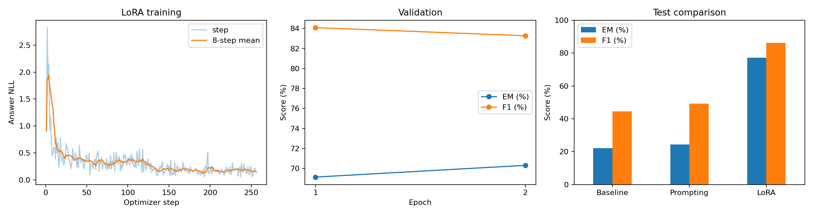

# LLM-project

从公开原料重新构建 SQuAD 1.1 生成式问答实验：下载数据 → 清洗、查重与文章划分 → Qwen3-0.6B baseline → 固定 3-shot prompting → LoRA → 本次运行报告。

可以选择**从头运行**，也可以**直接使用已发布的 epoch 2 权重和结果**。`run` 总是重新计算；`published/seed17_epoch2` 单独保存一次完整运行的记录，不会冒充你本机的新结果。

## 安装与运行

使用 **Python 3.12、Windows 或 Linux、支持所装 CUDA 版本的 NVIDIA GPU**。8 GB RTX 5060 是本项目使用的参考硬件；显存需求还取决于精度、batch 和输入长度。此实现不支持在 CPU 或 macOS 上完成训练。首次运行需联网下载原料和约 1.5 GB 模型；磁盘还需容纳数据、缓存与 adapter。

```bash
git clone https://github.com/sunweiyi2026-ship-it/LLM-project.git
cd LLM-project
conda create -n genqa python=3.12 -y
conda activate genqa
python -m pip install torch==2.7.1 --index-url https://download.pytorch.org/whl/cu128
python -m pip install -r requirements.txt
python -m pip install -e .
```

CUDA 12.8 安装命令适用于相应驱动和显卡；不能仅凭 `torch.cuda.is_available()` 判断兼容性。程序会先执行实际 CUDA 计算检查。

默认完整运行：

```bash
python -m genqa run --config configs/experiment.json
```

`run` 包含数据准备，并为本次预测、训练和报告创建新的 `runs/<运行ID>/`。原料与模型缓存可以复用；模型从固定底座新建 LoRA，不续训旧 adapter，不复用历史预测。

## 直接使用已训练模型

克隆项目后，`published/seed17_epoch2/` 中包含普通 Git 文件：epoch 2 LoRA 权重、配置、固定的 train/validation/test、提示词、三种方法的逐题预测、指标、训练日志和结果图。不需要 Git LFS，也不需要作者电脑的文件。

同学只需要权重时，取这两个文件：

- [adapter_config.json](published/seed17_epoch2/adapter/adapter_config.json)
- [adapter_model.safetensors](published/seed17_epoch2/adapter/adapter_model.safetensors)

它们是 **LoRA 增量权重**。固定版本的 Qwen3-0.6B 底座仍需首次下载（约 1.5 GB）；程序会校验底座和 tokenizer 的 8 个文件。两个 adapter 文件中的模型来源已改为公开模型名和固定 revision，没有作者的 C 盘路径。

先校验下载文件（不调用 GPU、不下载底座），再重新推理并评分（不训练）：

```bash
python -m genqa pretrained --verify-only
python -m genqa pretrained --split test
```

第二条命令对发布时的同一批 900 题实际生成答案，将本次输出写入新的 `runs/pretrained_<时间>/test/`。可将 `test` 改为 `validation` 或 `train`。如果已经有固定底座缓存，可追加 `--model-dir /path/to/qwen-snapshot`。

只查看已有结果，不需要 GPU：

- [三种方法的指标表](published/seed17_epoch2/reference/metrics.csv)
- [900 题前后回答](published/seed17_epoch2/reference/test_answers.csv)
- [训练曲线与比较图](published/seed17_epoch2/reference/results.png)
- [训练 token 实际消耗](published/seed17_epoch2/reference/budget_usage.json)
- [运行来源与文件校验清单](published/seed17_epoch2/manifest.json)

做推理优化时，可以直接取得模型对象，无需启动训练或完整评测：

```python
from genqa.pretrained import load_published_model

bundle = load_published_model(root=".")  # 在仓库根目录运行；可传 model_dir
model, tokenizer = bundle["model"], bundle["tokenizer"]
prompt = bundle["prompt"]
test_rows = bundle["rows"]["test"]
```

默认保持原模型精度、未合并 LoRA、非思考、greedy、batch 4 等设置。改变精度、量化、合并或解码方法属于新推理实验，应另存结果并对照原始指标；跨硬件不能承诺逐字节相同。

## 分步运行

也可以先检查数据准备，再运行实验或重建某次报告：

```bash
python -m genqa prepare --config configs/experiment.json
python -m genqa run --config configs/experiment.json
python -m genqa report --run-dir runs/<运行ID>
```

先确认环境能跑通，可执行小样本烟测：

```bash
python -m genqa run --config configs/experiment.json --smoke
```

烟测使用 16/8/8 条训练、验证、测试样本，单独标记为非正式运行；不能用它的指标或消耗代表完整实验。

Notebook 复用同一套 Python 实现。安装环境后注册内核：

```bash
python -m ipykernel install --user --name genqa --display-name "Python (GenQA)"
```

在 Jupyter 中打开 [notebooks/experiment.ipynb](notebooks/experiment.ipynb)，选择 `Python (GenQA)`，重启内核并从头运行。若尚未安装 Jupyter，可执行 `python -m pip install notebook`，再执行 `python -m notebook`。保存后打开已有输出只是显示结果；重新运行才会重新计算。

## 已发布的完整运行

来源运行 `20261115T182055_377596Z`，训练 seed 17，2048 条数据完整训练两轮。三种方法均完成 2048 题训练集诊断、256 题验证及 900 题测试；LoRA 每轮另有验证记录。

| 方法 | Test EM (%) | Test F1 (%) |
|---|---:|---:|
| Baseline | 22.1111 | 44.5315 |
| Prompting | 24.4444 | 49.1689 |
| LoRA | 77.1111 | 86.1260 |

实际累计训练输入 **939,880 token**，其中监督子集 **25,392 token**，上限 **1,000,000**；溢出重试 **0 次**。推理评测不占该训练 token 上限。

计算代码来自提交 [`36b3ddc`](https://github.com/sunweiyi2026-ship-it/LLM-project/tree/36b3ddc545d5fafbd09b0eefe1b2557f736a62b9)。本次包含公开原料重建、全量预测、真实 LoRA 训练与报告，不是此前的 smoke test，也不是旧 Notebook 固定划分的结果。这里只报告一次 seed17 正式运行，不冒充多 seed 均值。



## 数据与比较方法

原文、问题及答案来自 [MRQA 2019](https://github.com/mrqa/MRQA-Shared-Task-2019) 的 SQuAD 子集；使用 [官方 SQuAD 1.1](https://rajpurkar.github.io/SQuAD-explorer/) 恢复文章身份。MRQA 下载地址中的 `release/v2` 是发布版本，**不是 SQuAD 2.0**；本任务只包含有答案问题。

`prepare` 从公开原料执行规范化查重、5-word 近重复处理和文章映射，以 data seed 42 划分训练/验证文章，并保存数据、排除统计、来源哈希和配置。训练选样还会使用固定 tokenizer 检查完整序列长度与训练 token 预算。

| 集合 | 默认用途与规模 |
|---|---|
| 训练 | 从训练池固定选出 2,048 题；每个训练 seed 完整训练 2 轮 |
| 验证 | 256 题；检查 baseline、prompting 和两个 LoRA epoch |
| 测试 | 来自公开 dev 的 45 篇文章，每篇 20 题，共 900 题；与训练/验证文章隔离 |

新测试集不依赖私人历史预测目录，也不复刻旧项目的历史排除集合。因此，它与旧项目的 900 题不应视为同一测试集，旧分数不能直接搬来比较；公开 dev 也不是隐藏测试集。

三种方法使用同一底座及同一批评测题：

- **Baseline**：零样例短答案提示，不更新权重。
- **3-shot prompting**：明确要求最短原文答案，示例仅取自本次选定的训练数据，不更新权重。
- **LoRA**：沿用 baseline 提示，从原始底座新建 adapter；固定训练 seed 17、2 轮、r=8、alpha=16、dropout=0.05。每轮独立评验证集，最终固定第 2 轮，不按测试分数选择配置。

Baseline、prompting 和最终 LoRA 都对完整训练/验证/测试集合生成答案。训练集分数只作拟合诊断，尤其 few-shot 的三个示例本就属于训练数据；泛化结论看验证/测试集。

## 训练 token 预算

默认 `training.max_train_tokens=1_000_000`，按**每次训练运行、每个训练 seed**计量；重新运行或增加种子会额外消耗训练预算，不代表所有历史实验合计只有 1M。一个 input token 指训练序列中的非 padding token，包括 prompt、参考答案和 EOS；答案监督 token 是其中一部分，不能再相加。

准备阶段先计算 `2 × Σ每题完整序列长度`。若固定的 2,048 题训练两轮超过上限，程序报错，不偷偷改成更短的题或少训练一轮。训练时还累计 FP16 溢出重试消耗的非 padding token，重试同样占用上限；超限会停止并标记未完成。报告区分计划消耗、成功完成训练的消耗，以及包含重试的实际累计消耗。

历史实验的同一口径曾为 **935,638 input tokens**，其中 **25,658 为监督 tokens**。这只是说明预算口径的历史参照，不是新数据准备后的承诺；本次数字以实际分词及日志为准。默认 micro-batch 4、梯度累积 4，完整运行应为 128 次更新/轮、共 256 次更新及 4,096 次样本呈现。

默认配置已完成正式训练：计划 input 为 **939,880 tokens**，实际累计 input 为 **939,880 tokens**。计划、成功完成量、含重试消耗及 padding 数量均保存在发布包的预算日志中。

Baseline 和 prompting 的新增**训练** token 为 0，但推理需要真实计算。训练集生成评测、验证、测试、few-shot 输入，以及梯度 checkpoint 的额外内部计算不属于上述训练序列 token 计数。因此，1M 是明确的训练 token 上限，不代表总项目 token、FLOPs、时长或费用上限。

## 指标、结果与复现范围

EM 与 token F1 由本次自由生成答案计算：按 SQuAD/MRQA 规则规范化，多参考取最高匹配；只去除输出两端空白，不借参考答案抽取预测。统一使用 non-thinking、greedy、最多 64 个新 token、完整输入上限 8,192 token。

训练日志另记答案位置 NLL 和 teacher-forced token accuracy；后者给定正确答案前缀，不等于自由生成准确率。评测的 NLL/PPL/TF accuracy 使用 eval seed 42 固定的每集合最多 64 题；EM/F1 使用整个集合。

每次运行保留配置、原料/数据/代码/模型哈希、实际 dtype 和环境、逐题预测、训练日志与 adapter。结果只对应本次配置和数据；默认是一个训练 seed，不能解释成多 seed 均值。

固定模型 revision、数据顺序、seed 和确定性选项有助于复现，但不能保证跨 GPU、CUDA、操作系统或库版本逐位相同。`precision="auto"` 会选择原生 BF16，否则 FP16；实际精度会被记录。严格确定性遇到不支持的算子会报错，不静默降级。

本次交付已完成的验证：

- 25 项 CPU 单元测试通过，覆盖数据处理、token 预算及已训练模型发布/加载。
- 从缓存的官方原料独立重建两次，输出 JSONL 与 manifest 的 SHA256 完全一致。
- 在 Windows、Python 3.12、RTX 5060 上，以严格确定性设置完成 **16/8/8** 小样本 CLI 全流程：原料重建、baseline/3-shot 真实预测、LoRA 两轮训练、逐轮验证和报告均通过。

**新数据划分下的完整 2,048×2 GPU 训练及三种方法的完整评测已执行。**各阶段逐题预测重新计算的 EM/F1 与报告一致，发布包文件及模型来源均有 SHA256 校验。验证范围仍限于记录的参考环境；其他 GPU/精度的速度与数值结果应单独测量。

已使用发布副本重新加载模型并完整评测 900 题：**900/900 的原始回答、评分答案和输出 token 数均与正式运行一致**；EM/F1 及固定 64 题的逐题 NLL 也完全一致，期间没有训练。这是在相同机器与软件环境下的复现验证，跨硬件仍应记录差异。详见 [validation/checks.json](validation/checks.json)。

完整可调配置见 [configs/experiment.json](configs/experiment.json)。数据、模型和结果路径都相对仓库解析，不需要作者机器上的文件。
